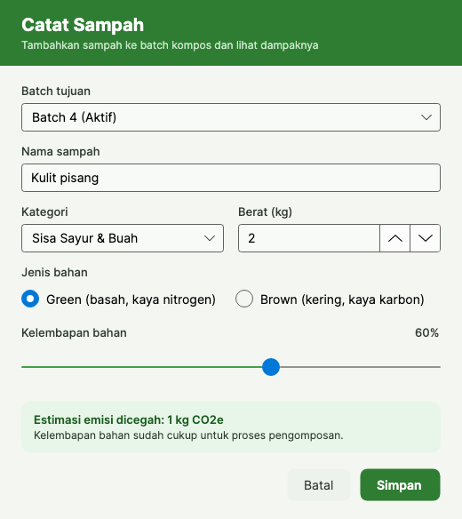
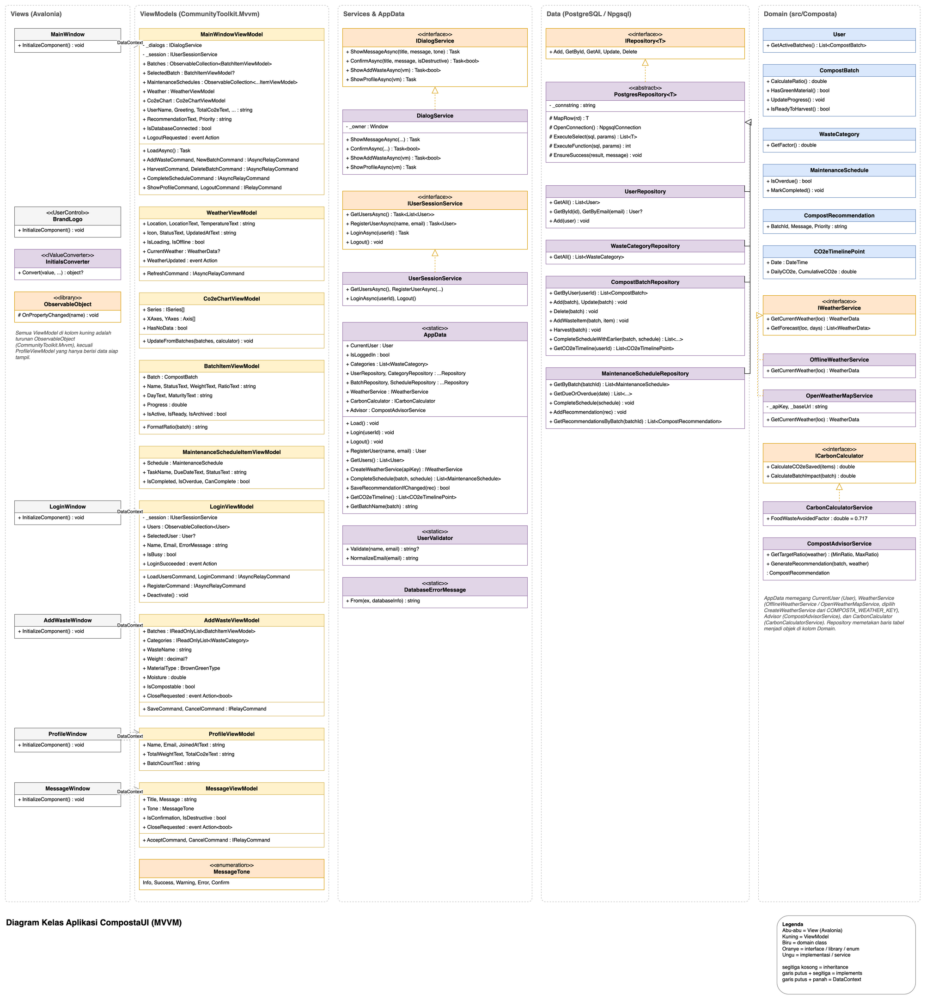

# Composta

Aplikasi desktop C# yang membantu mengubah sampah organik menjadi kompos secara optimal melalui rekomendasi berbasis data cuaca, sekaligus melacak estimasi emisi CO2e yang berhasil dicegah. Dibangun untuk mendukung aksi iklim (Climate Action) skala rumah tangga dan petani urban.

**Kelompok 15**  
Ketua Kelompok: Nayla Thalita - 24/535820/TK/59467  
Anggota 1: Nabil Aufa Danaputra - 24/535223/TK/59357  
Anggota 2: Gilbert S. H. Nainggolan - 24/543841/TK/60447  

## Daftar Isi
- [Fitur](#fitur)
- [Screenshot](#screenshot)
- [Instalasi Cepat (Paket Siap Pakai)](#instalasi-cepat-paket-siap-pakai)
- [Menjalankan dari Source Code](#menjalankan-dari-source-code)
- [Menjalankan Test](#menjalankan-test)
- [Dokumentasi](#dokumentasi)
- [Keputusan Teknis](#keputusan-teknis)
- [Struktur Repository](#struktur-repository)
- [Pembagian Tugas dan Aturan Kerja Tim](#pembagian-tugas-dan-aturan-kerja-tim)
- [Video Demo](#video-demo)

## Fitur

| Fitur | Keterangan |
|---|---|
| Profil pengguna | Pilih atau buat profil. Batch, sampah, dan dampak CO2e tiap profil terpisah. |
| Batch kompos | Buat, panen, dan hapus batch. Status (Aktif, Pematangan, Siap Panen, Sudah Dipanen) diperbarui otomatis. |
| Catat sampah | Nama, kategori, jenis brown/green, berat, dan kelembapan, lengkap dengan validasi dan pratinjau CO2e. Plastik dan kaca/logam ditandai tidak dapat dikompos. |
| Rekomendasi perawatan | Saran berdasarkan rasio brown/green, kelembapan, jadwal, dan cuaca. Target rasio menyesuaikan cuaca. |
| Cuaca dari web API | Cuaca saat ini dan prakiraan dari OpenWeatherMap, dengan data simulasi berlabel jelas saat API tidak tersedia. |
| Estimasi waktu matang | Dihitung dari prakiraan suhu dan kelembapan, bukan nilai tetap 60 hari. |
| Jadwal perawatan | Jadwal aduk, siram, cek kelembapan, dan panen dibuat otomatis, ditambah pengingat saat aplikasi dibuka. |
| Dampak CO2e | Total CO2e dicegah dan grafik akumulatif, memakai faktor EPA WARM per kategori. |
| Badge | Badge pencapaian, notifikasi badge baru, dan koleksi badge di profil. |

## Screenshot

| Dashboard | Catat Sampah |
|---|---|
|  |  |

## Instalasi Cepat (Paket Siap Pakai)

Paket aplikasi tidak memerlukan .NET SDK, cukup PostgreSQL.

| Sistem operasi | Isi paket |
|---|---|
| Windows | `Composta.exe`, `setup-database.bat`, `composta_postgres.sql`, `PANDUAN.md` |
| macOS (Apple Silicon) | `Composta`, `setup-database.command`, `composta_postgres.sql`, `PANDUAN.md` |

1. Install [PostgreSQL](https://www.postgresql.org/download/) dan catat password user `postgres`.
2. Jalankan `setup-database.bat` (Windows) atau `./setup-database.command` (macOS). Skrip membuat database
   `composta` beserta tabel, fungsi, dan data demo.
3. Jalankan `Composta.exe` (Windows) atau `./Composta` (macOS).

Panduan lengkap instalasi, konfigurasi database dan API key, cara penggunaan, serta solusi masalah umum ada di
[docs/panduan-instalasi.md](docs/panduan-instalasi.md).

Paket dibuat dari source code dengan:

```bash
./scripts/build-release.sh
```

Hasilnya ada di folder `dist/` (tidak ikut di-commit): `Composta-Windows.zip` dan `Composta-macOS.zip`.

## Menjalankan dari Source Code

### Prasyarat
- [.NET 8 SDK](https://dotnet.microsoft.com/download/dotnet/8.0)
- [PostgreSQL](https://www.postgresql.org/download/) (diuji dengan versi 16 dan 18) dan pgAdmin4 atau `psql`

### 1. Menyiapkan database
Jalankan `scripts/setup-database.command` (macOS) atau `scripts\setup-database.bat` (Windows), atau secara manual:

1. Buat database `composta` (lewat pgAdmin4 atau `createdb -U postgres composta`).
2. Jalankan [`src/CompostaUI/Database/composta_postgres.sql`](src/CompostaUI/Database/composta_postgres.sql) sebagai user
   `postgres` (Query Tool pgAdmin4, atau `psql -h localhost -U postgres -d composta -f src/CompostaUI/Database/composta_postgres.sql`).

> Jalankan ulang script setiap kali `composta_postgres.sql` berubah setelah `git pull`. Menjalankan ulang script akan
> mengganti data lama dengan data awal demo. Jalankan sebagai user yang sama dengan connection string aplikasi
> agar tidak muncul `permission denied`.

### 2. Mengatur connection string
Default: `Host=localhost;Port=5432;Username=postgres;Password=postgres;Database=composta`.
Jika berbeda (misalnya PostgreSQL di Windows memakai port 5434), atur environment variable `COMPOSTA_DB`:

```bash
# macOS / Linux
export COMPOSTA_DB="Host=localhost;Port=5432;Username=postgres;Password=rahasia;Database=composta"

# Windows (PowerShell)
$env:COMPOSTA_DB = "Host=localhost;Port=5434;Username=postgres;Password=rahasia;Database=composta"
```

### 3. Mengatur API key cuaca (opsional)
Cuaca aktual diambil dari [OpenWeatherMap](https://openweathermap.org/api). Buat API key gratis, lalu atur environment
variable `COMPOSTA_WEATHER_KEY`:

```bash
# macOS / Linux (simpan di ~/.zshrc agar permanen)
export COMPOSTA_WEATHER_KEY="api_key_anda"

# Windows (PowerShell)
$env:COMPOSTA_WEATHER_KEY = "api_key_anda"
```

Tanpa API key, atau saat API tidak merespons dalam 10 detik, aplikasi tetap berjalan dengan data cuaca simulasi yang
diberi label jelas. API key tidak boleh disimpan di kode maupun repository. Detail integrasi ada di
[src/CompostaUI/README.md](src/CompostaUI/README.md#integrasi-backend-cuaca-6).

### 4. Menjalankan aplikasi
```bash
cd src/CompostaUI
dotnet run
```

Pilih profil **Nabil Aufa Danaputra** untuk melihat data demo lengkap.

## Menjalankan Test

```bash
dotnet test tests/Composta.Tests
dotnet test tests/CompostaUI.Tests
```

- `Composta.Tests`: unit test model dan service inti (rasio dan status batch, rekomendasi, estimasi waktu matang,
  perhitungan CO2e, badge).
- `CompostaUI.Tests`: test ViewModel, validasi, login per user, layanan cuaca, repository, dan fungsi PostgreSQL. Test ini
  memakai database terpisah dari `COMPOSTA_TEST_DB` (default `composta_test`) dan **mengosongkan isinya** setiap kali
  dijalankan. Karena itu nama databasenya wajib diakhiri `_test`. Jika database test tidak tersedia, test database
  dilewati (skipped).

```bash
createdb -U postgres composta_test
export COMPOSTA_TEST_DB="Host=localhost;Port=5432;Username=postgres;Password=postgres;Database=composta_test"
dotnet test tests/CompostaUI.Tests
```

## Dokumentasi

| Dokumen | Isi |
|---|---|
| [docs/panduan-instalasi.md](docs/panduan-instalasi.md) | Instalasi paket, konfigurasi database dan API key, cara penggunaan, masalah umum |
| [docs/checklist-uji.md](docs/checklist-uji.md) | Checklist uji manual seluruh fitur sebelum demo |
| [docs/erd.md](docs/erd.md) | Relasi antar entitas serta tipe data dan besaran tiap atribut |
| [docs/faktor-co2e.md](docs/faktor-co2e.md) | Sumber dan perhitungan faktor CO2e (EPA WARM v16) |
| [docs/target-rasio-cuaca.md](docs/target-rasio-cuaca.md) | Aturan target rasio brown/green berdasarkan cuaca |
| [docs/estimasi-waktu-matang.md](docs/estimasi-waktu-matang.md) | Rumus estimasi waktu matang kompos dari prakiraan cuaca |
| [src/CompostaUI/README.md](src/CompostaUI/README.md) | Panduan pola MVVM dan detail fitur aplikasi |

### Class Diagram

Class diagram domain (rancangan awal):


Diagram kelas aplikasi CompostaUI dengan pola MVVM. Pada aplikasi, `SqliteRepository` di diagram domain digantikan oleh
`PostgresRepository<T>` beserta turunannya. File sumber: [docs/class-diagram-aplikasi.drawio](docs/class-diagram-aplikasi.drawio).



### Entity Relationship Diagram (ERD)


File sumber diagram: [docs/erd-composta.drawio](docs/erd-composta.drawio), skema SQL:
[src/CompostaUI/Database/composta_postgres.sql](src/CompostaUI/Database/composta_postgres.sql).

## Keputusan Teknis

Beberapa hal berbeda dari proposal awal:

| Proposal | Realisasi | Alasan |
|---|---|---|
| WPF | **Avalonia** | WPF hanya berjalan di Windows, sedangkan pengembangan juga dilakukan di macOS. Avalonia memakai XAML yang hampir sama dengan WPF dan berjalan di Windows, macOS, dan Linux. Model dan service di `src/Composta` dipakai bersama tanpa perubahan. |
| SQLite | **PostgreSQL** | Mengikuti materi praktikum (stored function `st_*`, pgAdmin4), tipe data dan constraint ditegakkan ketat oleh database, dan mendukung banyak user. |
| MVVM | **MVVM dengan CommunityToolkit.Mvvm** | View (`.axaml`) hanya berisi tampilan, logika ada di ViewModel sehingga dapat diuji tanpa membuka jendela. ViewModel tidak bergantung pada Avalonia, sehingga dapat dipakai ulang jika suatu saat pindah ke WPF. |
| Login pengguna | **Pilih profil tanpa password** | Composta dirancang untuk satu perangkat yang dipakai bersama, misalnya satu rumah tangga atau satu kebun. Profil dipakai untuk memisahkan batch dan dampak CO2e tiap orang, bukan untuk melindungi data rahasia. Jika aplikasi dipakai lintas perangkat, perlu ditambah autentikasi dengan password yang di-hash. |
| Faktor CO2e "data IPCC/EPA" | **EPA WARM versi 16** | Faktor tiap kategori dihitung dari selisih emisi TPA dan pengomposan di WARM, lengkap dengan sumber dan asumsinya. |
| Kredensial database | **Connection string lewat `COMPOSTA_DB`** | Nilai bawaan `postgres/postgres` hanya untuk pengembangan lokal. Di perangkat lain, kredensial diatur lewat environment variable, bukan diubah di kode. |
| Instalasi | **Paket self-contained dan skrip setup database** | Pengguna cukup menginstal PostgreSQL. Aplikasi sudah membawa runtime .NET, dan database disiapkan dengan satu skrip. |

## Struktur Repository

| Folder | Isi |
|---|---|
| `src/Composta` | Model, enum, interface, dan service inti dari class diagram. |
| `src/CompostaUI` | Aplikasi Avalonia + PostgreSQL (Views, ViewModels, Data, Services, Database). |
| `tests/Composta.Tests` | Unit test model dan service inti. |
| `tests/CompostaUI.Tests` | Test ViewModel, repository, dan fungsi PostgreSQL. |
| `scripts` | Skrip setup database dan pengemasan aplikasi. |
| `docs` | Panduan, class diagram, ERD, dokumentasi perhitungan, screenshot, dan halaman GitHub Pages. |

## Pembagian Tugas dan Aturan Kerja Tim

| Anggota | Role | Tanggung jawab | Branch |
|---|---|---|---|
| Nabil Aufa Danaputra | Software Architect, Backend & Database (inti), QA/Docs/PM | Class diagram, ERD, skema database, arsitektur MVVM, login user, unit test, dokumentasi, pengemasan, review PR | `535223` |
| Nayla Thalita | Frontend / UI | Tampilan Avalonia: cuaca, jadwal perawatan, login & profil, grafik dampak CO2e, koleksi badge | `535820` |
| Gilbert S. H. Nainggolan | Backend & Database (fitur) | Integrasi API cuaca, estimasi waktu matang, jadwal perawatan, data CO2e per tanggal, sistem badge | `543841` |

Detail pekerjaan tiap anggota ada di [GitHub Issues](https://github.com/Nabil-Aufa/composta/issues).

1. Setiap anggota bekerja di branch masing-masing (berdasarkan NIM) dan tidak push langsung ke `main`.
2. Sebelum mulai kerja, sinkronkan branch dengan `main` terbaru: `git pull origin main`.
3. Pesan commit menyebut nomor issue yang dikerjakan, misalnya `menambahkan service cuaca (#6)`.
4. Setiap satu issue selesai, buat Pull Request ke `main` dengan `Closes #<nomor>` di deskripsi.
5. Minimal 1 review dari anggota lain sebelum merge ke `main`.
6. Jika ada perubahan struktur tabel, ubah `composta_postgres.sql` lalu sesuaikan ERD dan `docs/erd.md`.
7. Jika ada class atau ViewModel baru, perbarui `docs/class-diagram-aplikasi.drawio` lalu export ulang PNG-nya.

## Video Demo

Menyusul ([#19](https://github.com/Nabil-Aufa/composta/issues/19)). Checklist uji sebelum demo: [docs/checklist-uji.md](docs/checklist-uji.md).
