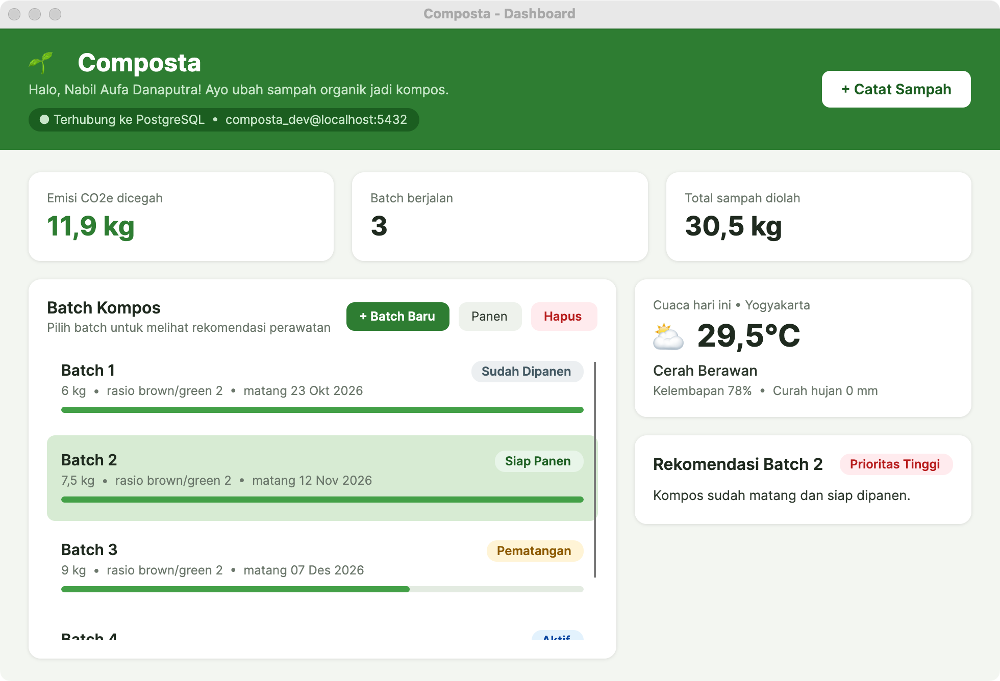
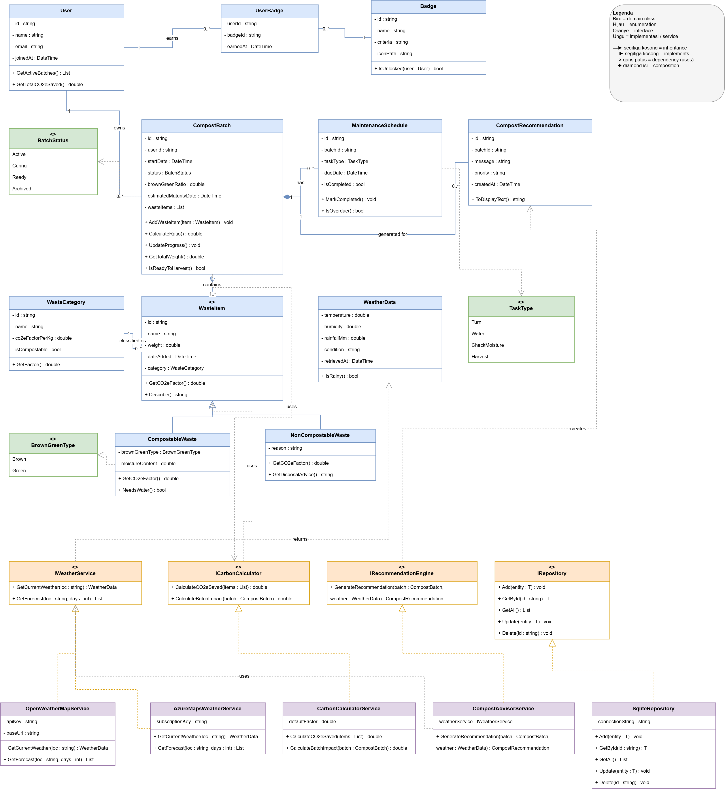
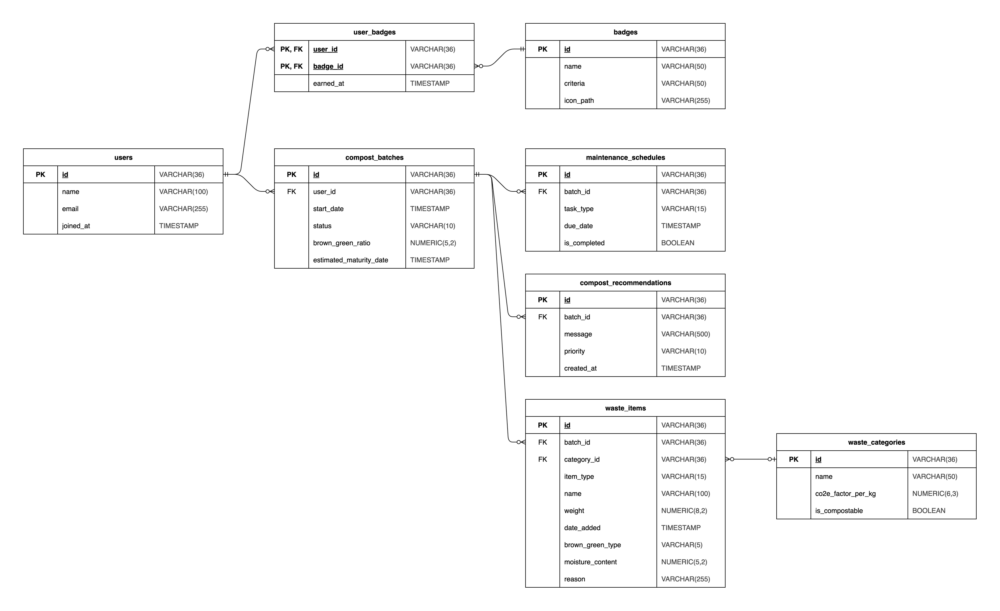

# composta

Aplikasi desktop C# yang membantu mengubah sampah organik menjadi kompos secara optimal melalui rekomendasi berbasis data cuaca, sekaligus melacak estimasi emisi CO2e yang berhasil dicegah. Dibangun untuk mendukung aksi iklim (Climate Action) skala rumah tangga dan petani urban.

Kelompok Composta  
Ketua Kelompok: Nayla Thalita - 24/535820/TK/59467  
Anggota 1: Nabil Aufa Danaputra - 24/535223/TK/59357  
Anggota 2: Gilbert S. H. Nainggolan - 24/543841/TK/60447  

## Pembagian Tugas

| Anggota | Role | Tanggung jawab | Branch |
|---|---|---|---|
| Nabil Aufa Danaputra | Software Architect, Backend & Database (inti), QA/Docs/PM | Class diagram, ERD, skema database, arsitektur MVVM, login user, unit test, dokumentasi, review PR | `535223` |
| Nayla Thalita | Frontend / UI | Tampilan Avalonia: cuaca, jadwal perawatan, login & profil, grafik dampak CO2e, badge | `535820` |
| Gilbert S. H. Nainggolan | Backend & Database (fitur) | Integrasi API cuaca, estimasi waktu matang, jadwal perawatan, data CO2e per tanggal, sistem badge | `543841` |

Detail pekerjaan tiap anggota ada di [GitHub Issues](https://github.com/Nabil-Aufa/composta/issues).

## Screenshot

| Dashboard | Catat Sampah |
|---|---|
|  |  |

## Cara Menjalankan

### Prasyarat
- [.NET 8 SDK](https://dotnet.microsoft.com/download/dotnet/8.0)
- [PostgreSQL](https://www.postgresql.org/download/) (diuji dengan versi 18) dan pgAdmin4 atau `psql`

### 1. Menyiapkan database
1. Buat database `composta` (lewat pgAdmin4 atau `createdb -U postgres composta`).
2. Jalankan [`src/CompostaUI/Database/composta_postgres.sql`](src/CompostaUI/Database/composta_postgres.sql) pada database tersebut
   (Query Tool pgAdmin4, atau `psql -U postgres -d composta -f src/CompostaUI/Database/composta_postgres.sql`).
   Script ini membuat tabel, fungsi `st_*`, dan data awal untuk demo.

> Setiap kali `composta_postgres.sql` berubah setelah `git pull`, jalankan ulang script tersebut. Jika skema database
> belum diperbarui, aplikasi akan menampilkan pesan "Skema database ... belum sesuai dengan versi aplikasi ini".
> Menjalankan ulang script akan mengganti data lama dengan data awal.

### 2. Mengatur connection string
Default: `Host=localhost;Port=5432;Username=postgres;Password=postgres;Database=composta`.
Jika berbeda (misalnya PostgreSQL di Windows memakai port 5434), atur environment variable `COMPOSTA_DB`:

```bash
# macOS / Linux
export COMPOSTA_DB="Host=localhost;Port=5432;Username=postgres;Password=rahasia;Database=composta"

# Windows (PowerShell)
$env:COMPOSTA_DB = "Host=localhost;Port=5434;Username=postgres;Password=rahasia;Database=composta"
```

### 3. Menjalankan aplikasi
```bash
cd src/CompostaUI
dotnet run
```

### 4. Mengatur API key cuaca (opsional)
Cuaca aktual diambil dari [OpenWeatherMap](https://openweathermap.org/api). Buat API key gratis, lalu atur environment
variable `COMPOSTA_WEATHER_KEY` sebelum `dotnet run`:

```bash
# macOS / Linux
export COMPOSTA_WEATHER_KEY="api_key_anda"

# Windows (PowerShell)
$env:COMPOSTA_WEATHER_KEY = "api_key_anda"
```

Tanpa API key, atau saat internet terputus dan API tidak merespons dalam 10 detik, aplikasi tetap berjalan dengan
data cuaca simulasi yang diberi label jelas di kartu cuaca. API key tidak boleh disimpan di kode maupun repository.
Detail integrasi ada di [src/CompostaUI/README.md](src/CompostaUI/README.md#integrasi-backend-cuaca-6).

## Menjalankan Test

```bash
dotnet test tests/Composta.Tests
dotnet test tests/CompostaUI.Tests
```

- `Composta.Tests`: unit test model dan service inti (`CompostAdvisorService`, `CarbonCalculatorService`, `CompostBatch`).
- `CompostaUI.Tests`: test validasi, login per user, repository, layanan cuaca, dan ViewModel yang terhubung ke PostgreSQL. Test ini memakai
  database terpisah dari `COMPOSTA_TEST_DB` (default `composta_test`) dan **mengosongkan isinya** setiap kali test
  dijalankan. Karena itu nama databasenya wajib diakhiri `_test`; selain itu test database ditolak. Jika database test tidak tersedia, test database
  dilewati (skipped).

```bash
createdb -U postgres composta_test
export COMPOSTA_TEST_DB="Host=localhost;Port=5432;Username=postgres;Password=postgres;Database=composta_test"
dotnet test tests/CompostaUI.Tests
```

## Keputusan Teknis

Beberapa hal berbeda dari proposal awal:

| Proposal | Realisasi | Alasan |
|---|---|---|
| WPF | **Avalonia** | WPF hanya berjalan di Windows, sedangkan pengembangan juga dilakukan di macOS. Avalonia memakai XAML yang hampir sama dengan WPF dan berjalan di Windows, macOS, dan Linux. Model dan service di `src/Composta` dipakai bersama tanpa perubahan. |
| SQLite | **PostgreSQL** | Mengikuti materi praktikum (stored function `st_*`, pgAdmin4), tipe data dan constraint ditegakkan ketat oleh database, dan mendukung banyak user. |
| MVVM | **MVVM dengan CommunityToolkit.Mvvm** | View (`.axaml`) hanya berisi tampilan, logika ada di ViewModel sehingga dapat diuji tanpa membuka jendela. ViewModel tidak bergantung pada Avalonia, sehingga dapat dipakai ulang jika suatu saat pindah ke WPF. Panduan ada di [src/CompostaUI/README.md](src/CompostaUI/README.md). |
| Login pengguna | **Pilih profil tanpa password** | Composta dirancang untuk satu perangkat yang dipakai bersama, misalnya satu rumah tangga atau satu kebun. Profil dipakai untuk memisahkan batch dan dampak CO2e tiap orang, bukan untuk melindungi data rahasia. Profil cukup berisi nama dan email unik. Jika aplikasi dipakai lintas perangkat, perlu ditambah autentikasi dengan password yang di-hash. |
| Kredensial database | **Connection string lewat `COMPOSTA_DB`** | Nilai bawaan `postgres/postgres` hanya untuk pengembangan lokal. Di perangkat lain, kredensial diatur lewat environment variable, bukan diubah di kode. |

## Struktur Repository

| Folder | Isi |
|---|---|
| `src/Composta` | Model, enum, interface, dan service inti dari class diagram (proyek WPF awal). |
| `src/CompostaUI` | Aplikasi Avalonia + PostgreSQL yang sedang dikembangkan (Views, ViewModels, Data, Services, Database). |
| `tests/Composta.Tests` | Unit test model dan service inti. |
| `tests/CompostaUI.Tests` | Test validasi, login per user, dan ViewModel dengan database. |
| `docs` | Class diagram, ERD, screenshot, dan halaman GitHub Pages. |

## Class Diagram

Class diagram domain (rancangan awal):



Diagram kelas aplikasi CompostaUI dengan pola MVVM. Pada aplikasi, `SqliteRepository` di diagram domain digantikan oleh
`PostgresRepository<T>` beserta turunannya. File sumber: [docs/class-diagram-aplikasi.drawio](docs/class-diagram-aplikasi.drawio).


## Entity Relationship Diagram (ERD)



Penjelasan relasi antar entitas serta tipe data dan besaran tiap atribut ada di [docs/erd.md](docs/erd.md).
File sumber diagram: [docs/erd-composta.drawio](docs/erd-composta.drawio), skema SQL: [src/CompostaUI/Database/composta_postgres.sql](src/CompostaUI/Database/composta_postgres.sql).

## Aturan Kerja Tim

1. Setiap anggota bekerja di branch masing-masing (berdasarkan NIM) dan tidak push langsung ke `main`.
2. Sebelum mulai kerja, sinkronkan branch dengan `main` terbaru: `git pull origin main`.
3. Pesan commit menyebut nomor issue yang dikerjakan, misalnya `menambahkan service cuaca (#6)`.
4. Setiap satu issue selesai, buat Pull Request dari branch masing-masing ke `main` dan tulis `Closes #<nomor>` di deskripsi.
5. Minimal 1 review dari anggota lain sebelum merge ke `main`.
6. Setelah PR di-merge, sinkronkan lagi branch dengan `main` sebelum lanjut ke issue berikutnya.
7. Jika ada perubahan struktur tabel, ubah `composta_postgres.sql` lalu sesuaikan ERD dan `docs/erd.md`.
8. Jika ada class atau ViewModel baru, perbarui `docs/class-diagram-aplikasi.drawio` lalu export ulang PNG-nya.

## Video Demo

Menyusul ([#19](https://github.com/Nabil-Aufa/composta/issues/19)). Checklist uji sebelum demo: [docs/checklist-uji.md](docs/checklist-uji.md).
