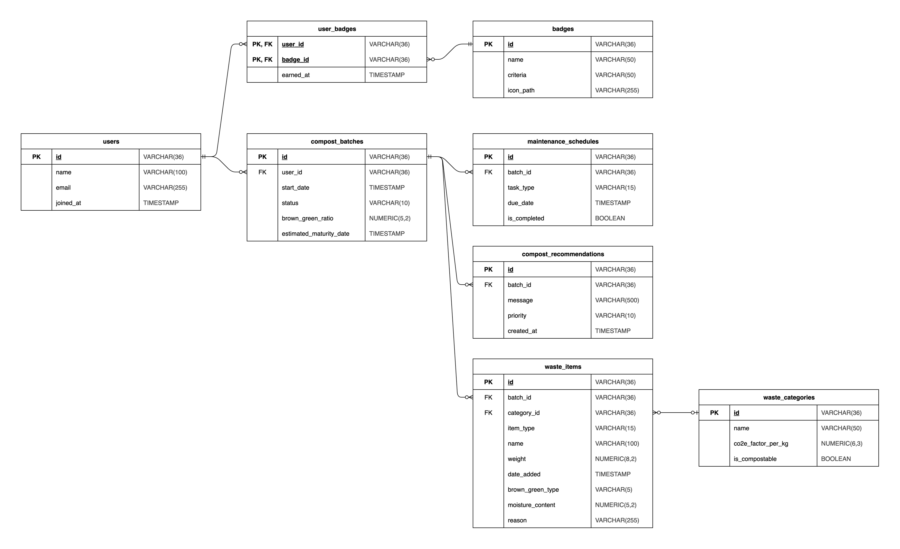

# Entity Relationship Diagram (ERD) Composta

File sumber diagram: [`erd-composta.drawio`](erd-composta.drawio) (buka di https://app.diagrams.net).
Skema SQL: [`src/CompostaUI/Database/composta_postgres.sql`](../src/CompostaUI/Database/composta_postgres.sql). File ini adalah satu-satunya sumber skema database.

ERD ini diturunkan dari class diagram Composta. Setiap domain class yang perlu disimpan menjadi satu tabel, sedangkan
`WeatherData` tidak dijadikan tabel karena datanya selalu diambil real-time dari API cuaca (OpenWeatherMap / Azure Maps)
dan tidak memiliki identitas (`id`).

## 1. Daftar Entitas

| Entitas | Asal class | Keterangan |
|---|---|---|
| `users` | `User` | Pengguna aplikasi (rumah tangga / petani urban). |
| `badges` | `Badge` | Master data lencana gamifikasi beserta kriterianya. |
| `user_badges` | `UserBadge` | Tabel penghubung lencana yang sudah diraih pengguna. |
| `compost_batches` | `CompostBatch` | Satu wadah/proses pengomposan milik pengguna. |
| `waste_items` | `WasteItem`, `CompostableWaste`, `NonCompostableWaste` | Sampah yang dimasukkan ke batch. |
| `waste_categories` | `WasteCategory` | Master kategori sampah dan faktor emisi CO2e per kg. |
| `maintenance_schedules` | `MaintenanceSchedule` | Jadwal perawatan batch (aduk, siram, cek kelembapan, panen). |
| `compost_recommendations` | `CompostRecommendation` | Rekomendasi yang dihasilkan `CompostAdvisorService` untuk batch. |

## 2. Relasi Antar Entitas

Notasi yang dipakai adalah crow's foot: `||` = tepat satu (mandatory one), `o|` = nol atau satu (optional one),
`o<` = nol atau banyak (optional many).

| Relasi | Kardinalitas | Penjelasan |
|---|---|---|
| `users` → `compost_batches` | One (mandatory) to Many (optional) | Satu pengguna dapat memiliki nol atau banyak batch kompos, tetapi setiap batch wajib dimiliki tepat satu pengguna (`compost_batches.user_id`). Sesuai asosiasi *owns* `User 1 — 0..* CompostBatch`. |
| `users` ↔ `badges` melalui `user_badges` | Many to Many | Satu pengguna dapat meraih banyak lencana dan satu lencana dapat diraih banyak pengguna. Relasi M:N dipecah menjadi dua relasi 1:N dengan tabel `user_badges` yang menyimpan `user_id`, `badge_id`, dan waktu diraih (`earned_at`). PK gabungan `(user_id, badge_id)` mencegah lencana yang sama tercatat dua kali untuk satu pengguna. |
| `compost_batches` → `waste_items` | One (mandatory) to Many (optional) | Satu batch berisi banyak item sampah, dan setiap item wajib berada di satu batch (`waste_items.batch_id`). Ini adalah relasi komposisi pada class diagram, sehingga item ikut terhapus bila batch dihapus (`ON DELETE CASCADE`). Di class diagram kardinalitasnya `1..*`, tetapi di database dibuat `0..*` karena batch baru dibuat dulu sebelum item ditambahkan. |
| `waste_categories` → `waste_items` | One (optional) to Many (optional) | Satu kategori dapat dipakai banyak item. `category_id` boleh `NULL` karena di kode `WasteItem.Category` bertipe nullable (`WasteCategory?`) dan ditampilkan sebagai "Tanpa kategori". |
| `compost_batches` → `maintenance_schedules` | One (mandatory) to Many (optional) | Satu batch memiliki nol atau banyak jadwal perawatan; setiap jadwal milik tepat satu batch (`maintenance_schedules.batch_id`). |
| `compost_batches` → `compost_recommendations` | One (mandatory) to Many (optional) | Setiap kali rekomendasi dibuat untuk sebuah batch, disimpan sebagai riwayat. Satu batch dapat memiliki banyak rekomendasi; setiap rekomendasi milik tepat satu batch. |

### Pewarisan `WasteItem`

`CompostableWaste` dan `NonCompostableWaste` adalah turunan dari class abstrak `WasteItem`. Di database keduanya
disimpan dalam satu tabel `waste_items` (*single table inheritance*):

- `item_type` menandai jenis turunan (`compostable` / `noncompostable`), sama dengan diskriminator JSON pada kode.
- `brown_green_type` dan `moisture_content` hanya diisi untuk `compostable`.
- `reason` hanya diisi untuk `noncompostable`.

Pilihan ini membuat kueri total berat dan total CO2e per batch cukup dilakukan pada satu tabel tanpa `JOIN` tambahan.

## 3. Tipe Data dan Besaran Atribut

Aplikasi memakai PostgreSQL. Berbeda dengan SQLite, PostgreSQL menegakkan tipe data dan besarannya secara ketat:
teks yang melebihi `VARCHAR(n)` atau angka yang melebihi jumlah digit `NUMERIC(p,s)` ditolak oleh database, sedangkan
digit desimal yang berlebih dibulatkan sesuai skala `s`. Besaran `(n)` juga divalidasi di aplikasi sebelum data
disimpan.

**Aturan umum**

- Semua `id` dan foreign key memakai **`VARCHAR(36)`** karena id dibuat dengan `Guid.NewGuid().ToString()`, yang selalu
  menghasilkan 36 karakter (32 digit heksadesimal + 4 tanda hubung), misalnya `3f2504e0-4f89-11d3-9a0c-0305e82c3301`.
- Semua atribut tanggal/waktu memakai **`TIMESTAMP`** (tanpa zona waktu) karena di kode bertipe `DateTime` dan membutuhkan
  tanggal sekaligus jam. Aplikasi hanya dipakai di satu zona waktu lokal, sehingga zona waktu tidak perlu disimpan.
- Semua angka desimal memakai **`NUMERIC(p,s)`**, bukan `REAL`/`DOUBLE PRECISION`, agar nilai berat, rasio, dan faktor
  emisi tersimpan persis tanpa galat pembulatan *floating point*.
- Atribut benar/salah memakai tipe **`BOOLEAN`** bawaan PostgreSQL.
- Nilai `enum` C# (`BatchStatus`, `TaskType`, `BrownGreenType`) disimpan sebagai **teks** (bukan angka) agar data tetap
  terbaca dan tidak rusak bila urutan enum berubah; panjangnya disesuaikan dengan nama enum terpanjang.

### `users`

| Atribut | Tipe | Key | Alasan tipe & besaran |
|---|---|---|---|
| `id` | VARCHAR(36) | PK | GUID string 36 karakter. |
| `name` | VARCHAR(100) | | Nama lengkap orang Indonesia umumnya < 100 karakter. |
| `email` | VARCHAR(255) | UNIQUE | Batas praktis panjang alamat email; unik agar satu email satu akun. |
| `joined_at` | TIMESTAMP | | Waktu pendaftaran pengguna. |

### `badges`

| Atribut | Tipe | Key | Alasan tipe & besaran |
|---|---|---|---|
| `id` | VARCHAR(36) | PK | GUID string. |
| `name` | VARCHAR(50) | | Nama lencana singkat, mis. "Pahlawan Iklim". |
| `criteria` | VARCHAR(50) | | Format `JENIS:TARGET` yang dibaca `Badge.IsUnlocked()`, mis. `CO2E:10`, `BATCH:3`, `HARVEST:1`. |
| `icon_path` | VARCHAR(255) | | Path relatif file ikon; 255 cukup untuk path di Windows. |

### `user_badges`

| Atribut | Tipe | Key | Alasan tipe & besaran |
|---|---|---|---|
| `user_id` | VARCHAR(36) | PK, FK → `users.id` | Mengikuti tipe PK yang dirujuk. |
| `badge_id` | VARCHAR(36) | PK, FK → `badges.id` | Mengikuti tipe PK yang dirujuk. |
| `earned_at` | TIMESTAMP | | Waktu lencana diraih. |

### `compost_batches`

| Atribut | Tipe | Key | Alasan tipe & besaran |
|---|---|---|---|
| `id` | VARCHAR(36) | PK | GUID string. |
| `user_id` | VARCHAR(36) | FK → `users.id` | Pemilik batch. |
| `start_date` | TIMESTAMP | | Tanggal mulai pengomposan. |
| `status` | VARCHAR(10) | | Enum `BatchStatus`: `Active`, `Curing`, `Ready`, `Archived` (terpanjang 8 karakter). |
| `brown_green_ratio` | NUMERIC(10,2) | | Hasil `CalculateRatio()` yang dibulatkan 2 desimal; maksimal 99.999.999,99 agar rasio ekstrem (misalnya 1.000 kg brown dengan 0,5 kg green) tetap bisa disimpan. |
| `estimated_maturity_date` | TIMESTAMP | | Tanggal sampah kompos terakhir (atau `start_date` bila belum ada sampah) + jumlah hari pematangan dari estimasi cuaca (default 60 hari). |

### `waste_categories`

| Atribut | Tipe | Key | Alasan tipe & besaran |
|---|---|---|---|
| `id` | VARCHAR(36) | PK | GUID string. |
| `name` | VARCHAR(50) | | Nama kategori, mis. "Sisa sayur", "Daun kering". |
| `co2e_factor_per_kg` | NUMERIC(6,3) | | Faktor emisi yang dicegah, kg CO2e per kg sampah; 3 desimal cukup presisi, maksimal 999.999. Sumber nilai: [faktor-co2e.md](faktor-co2e.md). |
| `is_compostable` | BOOLEAN | | Benar/salah; bila salah `GetFactor()` bernilai 0. |

### `waste_items`

| Atribut | Tipe | Key | Alasan tipe & besaran |
|---|---|---|---|
| `id` | VARCHAR(36) | PK | GUID string. |
| `batch_id` | VARCHAR(36) | FK → `compost_batches.id` | Batch tempat item dimasukkan. |
| `category_id` | VARCHAR(36) | FK → `waste_categories.id` (nullable) | Kategori sampah, boleh kosong. |
| `item_type` | VARCHAR(15) | | Diskriminator `compostable` / `noncompostable` (terpanjang 14 karakter). |
| `name` | VARCHAR(100) | | Nama item sampah. |
| `weight` | NUMERIC(8,2) | | Berat dalam kg, 2 desimal, tidak boleh negatif (sesuai validasi `WasteItem.Weight`); maksimal 999999.99 kg. |
| `date_added` | TIMESTAMP | | Waktu item ditambahkan. |
| `brown_green_type` | VARCHAR(5) | | Enum `BrownGreenType`: `Brown` / `Green`. Hanya untuk compostable. |
| `moisture_content` | NUMERIC(5,2) | | Persentase kelembapan 0–100 (di-*clamp* di kode). Hanya untuk compostable. |
| `reason` | VARCHAR(255) | | Alasan sampah tidak dapat dikomposkan. Hanya untuk noncompostable. |

### `maintenance_schedules`

| Atribut | Tipe | Key | Alasan tipe & besaran |
|---|---|---|---|
| `id` | VARCHAR(36) | PK | GUID string. |
| `batch_id` | VARCHAR(36) | FK → `compost_batches.id` | Batch yang dirawat. |
| `task_type` | VARCHAR(15) | | Enum `TaskType`: `Turn`, `Water`, `CheckMoisture`, `Harvest` (terpanjang 13 karakter). |
| `due_date` | TIMESTAMP | | Batas waktu tugas, dipakai `IsOverdue()`. |
| `is_completed` | BOOLEAN | | Status selesai, diubah oleh `MarkCompleted()`. |

### `compost_recommendations`

| Atribut | Tipe | Key | Alasan tipe & besaran |
|---|---|---|---|
| `id` | VARCHAR(36) | PK | GUID string. |
| `batch_id` | VARCHAR(36) | FK → `compost_batches.id` | Batch yang diberi rekomendasi. |
| `message` | VARCHAR(500) | | Pesan rekomendasi bisa berisi beberapa saran sekaligus, sehingga diberi ruang lebih panjang. |
| `priority` | VARCHAR(10) | | `Low`, `Medium`, `High` sesuai `CompostAdvisorService`. |
| `created_at` | TIMESTAMP | | Waktu rekomendasi dibuat. |

## Catatan Implementasi

Skema dibuat oleh script [`composta_postgres.sql`](../src/CompostaUI/Database/composta_postgres.sql), yang juga berisi
fungsi CRUD `st_select_*`, `st_insert_*`, `st_update_batch`, `st_delete_batch`, dan data awal. Script dapat dijalankan
berulang kali karena diawali `DROP TABLE IF EXISTS ... CASCADE`.

Akses data di aplikasi dilakukan oleh kelas turunan `PostgresRepository<T>` di `src/CompostaUI/Data` yang memanggil
fungsi-fungsi `st_*` tersebut melalui Npgsql. Setiap perubahan struktur tabel dilakukan di script ini, lalu ERD dan
dokumen ini disesuaikan.
